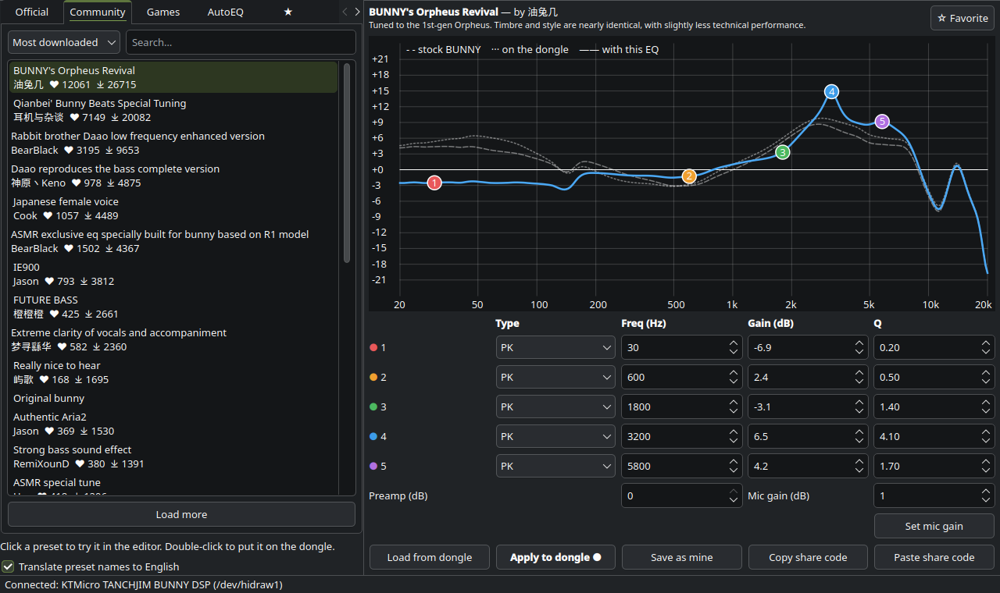
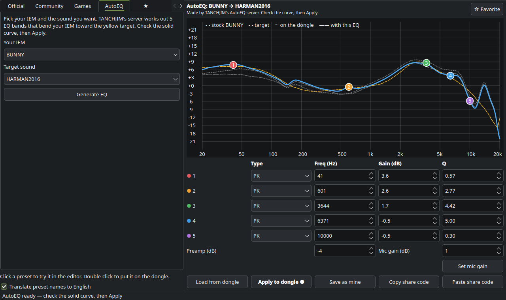
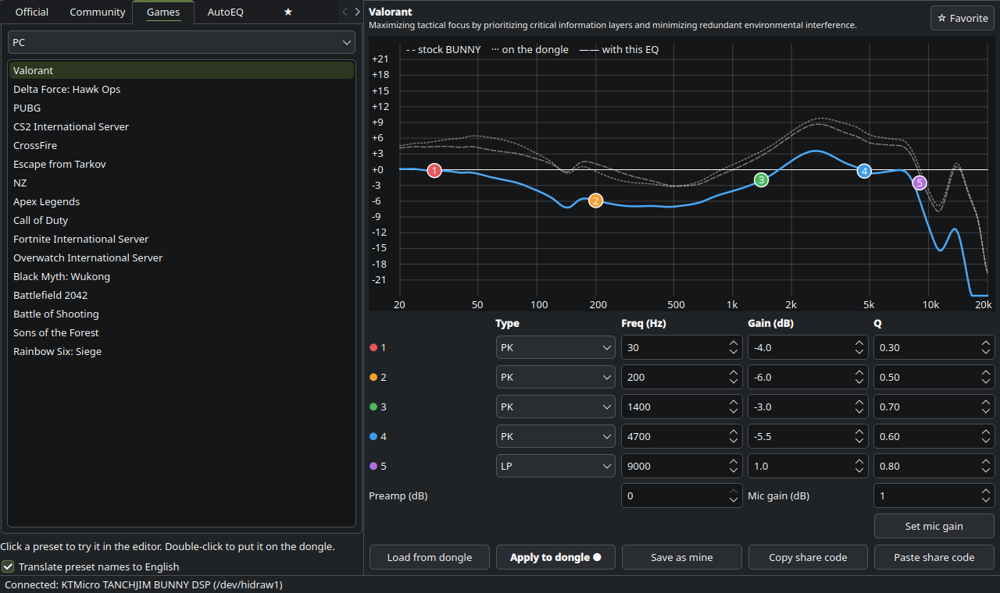

<p align="center"></p>

<h1 align="center">Halo EQ</h1>

<p align="center">
The TANCHJIM EQ app, for Linux.<br>
Tune your TANCHJIM DSP dongle with official, community and game presets, AutoEQ, and your own curves.<br>
No account needed.
</p>



## Features

- **Official presets:** TANCHJIM's own tunings for your model.
- **Community presets:** thousands of user tunings from TANCHJIM's EQ forum. Sort them by newest, most downloaded or most liked, and search them.
- **Game presets:** tuned for Valorant, CS2, PUBG, Fortnite, Zelda and more, for Phone, PC or Switch.
- **AutoEQ:** pick your IEM and a target sound (Harman, ISO DF, TANCHJIM …), and TANCHJIM's server computes the EQ for you.
- **Editor:** a 5-band parametric EQ (peaking, low and high shelf, and low-pass on band 5). Drag a dot on the graph to change frequency and gain, and scroll on it to change Q.
- **What you hear:** like the TANCHJIM app, the graph shows your IEM's measured response with the EQ on top, over a dashed line of the stock IEM. A dotted line shows what is saved on the dongle, so you can compare before you apply. Pick your IEM in the AutoEQ tab.
- **Mic gain:** −15 to +15 dB.
- **★ Favorites and your own presets:** kept offline, on your PC.
- **Share codes:** the same format as the official app. You can also import and export Equalizer APO / AutoEQ `ParametricEQ.txt` files.
- **Translation:** Chinese preset names are translated to English (optional).

| AutoEQ | Game presets |
|---|---|
|  |  |

## Supported devices

| Device | Status |
|---|---|
| TANCHJIM BUNNY DSP | ✅ Tested: EQ, low-pass, mic gain |
| TANCHJIM ONE DSP, FISSION DSP | Should work (same chip and register layout per [devicePEQ](https://github.com/jeromeof/devicePEQ)), untested |
| Other TANCHJIM dongles on the KT Micro chip (USB `31b2`) | Read-only: presets and AutoEQ only, no writing |
| Space Pro, OLA II DSP, Stargate II, Bluetooth models | Not supported: they use a different chip and protocol |

Got another model? Run `./halo_eq.py --probe` (it only reads) and open an issue with the output.

## Install

Commands are for bash or zsh.

**1. Get PySide6**, then set `PY` to the Python that has it:

```sh
# Fedora
sudo dnf install python3-pyside6 && PY=$(command -v python3)
# Arch
sudo pacman -S pyside6 && PY=$(command -v python3)
# Debian, Ubuntu and anything else: a private venv (distros block plain `pip install`)
python3 -m venv ~/.local/share/halo-eq/venv && ~/.local/share/halo-eq/venv/bin/pip install PySide6 \
  && PY=~/.local/share/halo-eq/venv/bin/python
```

**2. Get Halo EQ and let your user talk to the dongle** (once):

```sh
git clone https://github.com/lanenur/halo-eq.git && cd halo-eq
sudo cp 70-ktmicro-dsp.rules /etc/udev/rules.d/
sudo udevadm control --reload && sudo udevadm trigger
```

**3. Run it:**

```sh
"$PY" halo_eq.py
```

Optional: add it to your app menu (run from the `halo-eq` folder, with `PY` still set).

```sh
mkdir -p ~/.local/bin ~/.local/share/applications
printf '#!/bin/sh\nexec "%s" "%s" "$@"\n' "$PY" "$PWD/halo_eq.py" > ~/.local/bin/halo-eq && chmod +x ~/.local/bin/halo-eq
printf '[Desktop Entry]\nType=Application\nName=Halo EQ\nExec=%s\nIcon=%s\nCategories=AudioVideo;Audio;\n' \
  "$HOME/.local/bin/halo-eq" "$PWD/icon.svg" > ~/.local/share/applications/halo-eq.desktop
```

## Using it

- **Click** a preset to load it into the editor. **Double-click** to put it on the dongle.
- **Apply to dongle** saves the EQ on the dongle itself, so it works on any device you plug it into: phone, PC, console.
- The dongle **beeps and reconnects** for a second after every save. That is normal.
- **Apply to dongle ●** means the editor differs from what is on the dongle.

## Safety

Writing to a device is the only risky thing an EQ app does, so Halo EQ is careful:

- It never touches firmware. It only writes the EQ and mic gain registers, exactly like the official app.
- On connect it reads the EQ and checks the values make sense. If they don't, writing is blocked.
- It writes only to models confirmed to use this layout. Others are read-only.
- Every value is clamped to a safe range: freq 20–20000 Hz, gain ±12 dB, Q 0.1–10, preamp −12–0 dB.
- Apply writes, **reads back and compares**, and only then saves. If anything differs, nothing is saved: replug the dongle to restore the old EQ.
- It skips writing when nothing changed, and it backs up the dongle's EQ to *Mine* the first time it sees it.

## FAQ

**Do I need a TANCHJIM account?**
No. Browsing presets, games and AutoEQ works without logging in. Uploading and liking presets needs an account, and Halo EQ leaves those out on purpose. Your favorites and presets stay on your PC.

**What goes over the network?**
Only requests to TANCHJIM's preset server, the AutoEQ curve files, and, if translation is on, preset names sent to Google Translate. Nothing about you or your device is sent. The dongle features work offline.

**Is there live preview while I drag?**
No. These dongles go silent if EQ values change without being saved, so Halo EQ saves once, when you press Apply.

**Why does AutoEQ not boost the treble much?**
Measurements above about 10 kHz depend on the measuring rig and fit, not on your ear. Correcting them sounds harsh, so Halo EQ only lets AutoEQ correct 20 Hz – 10 kHz, gently.

## Where things are stored

| What | Where |
|---|---|
| Your presets | `~/.config/halo-eq/presets.json` |
| Favorites | `~/.config/halo-eq/favorites.json` |
| Settings | `~/.config/halo-eq/settings.json` |
| AutoEQ curves, translations | `~/.cache/halo-eq/` |

## How it works

- **Device:** USB HID, report `0x4B`, payload `reg 0 0 0 cmd 0 d0 d1 d2 d3`. Commands: `0x52` read, `0x57` write, `0x53` save.
  - Band *i* uses register `0x26+2i` for gain ×10 (int16 LE) and freq in Hz (uint16 LE), and register `0x27+2i` for Q ×1000 (uint16 LE) and type (0 PK, 1 LP on band 5 only, 3 LS, 4 HS).
  - Register `0x66` is preamp (int8 dB) and `0x65` is mic gain (int8, dB ×2).
  - Halo EQ talks to `/dev/hidraw*` directly, with no extra libraries.
- **Presets and AutoEQ:** TANCHJIM's public app API at `angelapi.tanchjim.com/api/v1/eqManage/`.
- `./halo_eq.py --selftest` runs the built-in checks.

## Credits

- [jeromeof/devicePEQ](https://github.com/jeromeof/devicePEQ) for documenting the KT Micro protocol.
- TANCHJIM and the community tuners whose presets this app browses.

## Disclaimer

Halo EQ is an unofficial, community-made app. It is not affiliated with or endorsed by TANCHJIM. "TANCHJIM" and product names belong to their owners. Use at your own risk.

## License

[MIT](LICENSE)
